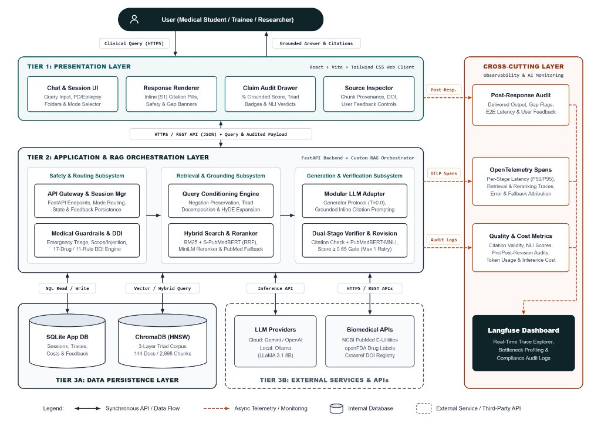

# NeuroEvidence

**NeuroEvidence** is an educational and health informatics research copilot for neurological inquiries, specializing in **Parkinson's disease** and **epilepsy**. It combines a curated **3-Layer Triad Knowledge Base** (144 documents / 2,998 indexed chunks), **Query Conditioning with Selective Multi-Hop Decomposition & HyDE**, **Hybrid Dense-Sparse Retrieval with Neural Cross-Encoder Reranking**, **Agentic Live PubMed Fallback**, **Dual-Stage Biomedical NLI Verification with Bounded Revision**, a **Hybrid Rule + openFDA Drug-Drug Interaction (DDI) Safety Engine**, and **Langfuse Observability**.

> [!IMPORTANT]
> **Educational & Research Software Only:** NeuroEvidence is designed strictly for academic evaluation and clinical informatics research. It is **not** a certified medical device and must never be used for clinical diagnosis, prescribing, or direct patient treatment.

---

## 🏗️ System Architecture



NeuroEvidence is structured into three core architectural tiers plus a cross-cutting AI observability layer:

- **Tier 1 — Presentation Layer (`React + Vite + Tailwind CSS`):** Interactive clinical workspace featuring domain-organized session folders, a 4-mode execution switcher (Cloud/Local × RAG/Baseline), inline `[S1]` layer-badged citation pills, safety & evidence-gap banners, a Claim Audit Drawer, a Source Inspector, and a Researcher Mode dashboard.
- **Tier 2 — Application & RAG Orchestration Layer (`FastAPI + Custom RAG Orchestrator`):** Coordinates safety guardrails (emergency triage, scope/injection defense, 17-drug / 11-rule + openFDA DDI engine), query conditioning (negation preservation, Triad decomposition, HyDE), hybrid search & neural reranking (BM25 + `S-PubMedBERT` RRF + MiniLM cross-encoder + live PubMed fallback), modular LLM generation (`T=0.0`), and dual-stage verification (`Crossref` + `PubMedBERT-MNLI`) with bounded revision (max 1 retry gated at `evidence_score >= 0.65`).
- **Tier 3 — Persistence & External Services:** Local **SQLite** database (sessions, traces, token/cost telemetry, user feedback), **ChromaDB (HNSW)** vector index for the 3-Layer Triad corpus, multi-provider LLM backends (**Google Gemini**, **OpenAI**, and local on-device **Ollama / Llama 3.1 8B**), and biomedical APIs (**NCBI PubMed E-Utilities**, **openFDA Drug Labels**, **Crossref DOI Registry**).
- **Cross-Cutting Layer — Observability & AI Monitoring (`Langfuse + OpenTelemetry`):** Captures per-stage latency spans, retrieval/reranking traces, pre- and post-revision NLI audit metrics, token/cost accounting, and user feedback scores.

---

## 🌟 Key Capabilities & Architectural Innovations

- 🏛️ **Curated 3-Layer Triad Knowledge Base (`144` Docs / `2,998` Chunks):** Hierarchical clinical corpus separating foundational pathophysiology (**Layer 1:** StatPearls / NCBI Bookshelf), consensus guidelines (**Layer 2:** NICE NG217 & NG71), and empirical trials/reviews (**Layer 3:** PubMed Central, *Lancet* SANAD II, Cochrane).
- ⚡ **Multi-Provider LLM Engine & 4 Execution Modes:** Supports **Google Gemini** (default `models/gemini-3.1-flash-lite` with automatic fallback candidates up to `gemini-3.8-flash`), **OpenAI** (`gpt-4.1-mini`, `gpt-4o`), and **local on-device Ollama** (`llama3.1:8b`). Users and benchmarks can run four distinct modes:
  - `rag_verified` — Cloud LLM + 3-Layer Triad RAG + NLI Verification
  - `baseline` — Cloud LLM parametric zero-shot (no retrieval)
  - `ollama_rag` — On-device Ollama LLM + 3-Layer Triad RAG + NLI Verification
  - `ollama_baseline` — On-device Ollama parametric zero-shot (no retrieval)
  - Also includes **Smart Demo Mode** (real LLM synthesis over the bundled corpus) and **Offline Demo Mode** (zero API keys or GPU required).
- 🧩 **Query Conditioning, Selective Multi-Hop Decomposition & HyDE:** Preserves clinical negations and conversational continuity across turns, selectively decomposes multi-part questions into layer-targeted Triad subqueries, and optionally applies Hypothetical Document Embeddings (`ENABLE_HYDE=true`) to improve recall.
- 🎯 **Hybrid Retrieval & Neural Cross-Encoder Reranking:** Fuses BM25 lexical matching and dense biomedical embeddings (`pritamdeka/S-PubMedBert-MS-MARCO`, or Gemini/OpenAI embeddings) via Reciprocal Rank Fusion (RRF), refined by a neural cross-encoder reranker (`cross-encoder/ms-marco-MiniLM-L-6-v2`).
- 🌐 **Agentic Live PubMed Fallback:** When local Layer 3 evidence is absent, lacks the queried drug entity, or falls below relevance threshold (`0.45`), the engine autonomously queries NCBI PubMed via E-utilities with clinical filters (trials, systematic reviews, humans, 2015+), reranks candidates, and dynamically auto-indexes fresh chunks into ChromaDB.
- 🛡️ **Dual-Stage Biomedical NLI Verification & Bounded Revision:** Validates citation metadata via Crossref and scores sentence-level claim entailment using `pritamdeka/PubMedBERT-MNLI-MedNLI` (*Supported*, *Contradicted*, or *Insufficient*). Unsupported claims trigger cross-chunk fallback, targeted secondary retrieval, and up to one bounded revision pass before final re-verification (`evidence_score >= 0.65` gate).
- 💊 **Clinical Safety Guardrails & Hybrid DDI Engine:** Deterministic pre-routing for emergencies (e.g., status epilepticus), out-of-scope or personal medical advice abstention, adversarial citation-fabrication rejection, and real-time publication-lag disclosure. Combines a **17-drug / 11-rule** neurological DDI registry (e.g., sodium valproate + lamotrigine SJS risk; metoclopramide + levodopa D2 antagonism) with live **openFDA** drug-label interaction warnings.
- 📈 **Langfuse Observability & OpenTelemetry Tracing:** Logs end-to-end spans (`chat_pipeline`, `ddi_analysis`, `triad_retrieval`, `live_pubmed_search`, `nli_verification`, `revised_nli_verification`), evidence scores, LLM-as-a-Judge scores, and user feedback directly to Langfuse when configured.
- 👤 **Human-in-the-Loop Literature Curation:** Protocolized candidate discovery (`discover`), human review and manifest promotion (`accept-candidates`), full-text JATS XML fetching (`fetch`), and ChromaDB indexing (`index`).
- 💻 **Modern Clinical Copilot UI:** Built with React 18, Vite, Tailwind CSS, and Lucide icons; includes drag-and-drop Parkinson's/Epilepsy session folders, domain-reactive prompts, inline `[S1]` Triad layer citation pills, Claim Audit Drawer, Source Inspector, and a **Researcher Mode** toggle for the Evaluation & Metrics dashboard.

---

## 🚀 Quick Start

> [!NOTE]
> The repository ships **pre-configured with the bundled Triad knowledge base**. You can launch and inspect the entire system immediately in offline demo mode without external API keys or GPU hardware.

### 1. Environment Configuration

Copy the example environment file:

```powershell
Copy-Item .env.example .env
```

Configure your runtime in `.env`:

- **Google Gemini (Default Cloud Provider):** Set `LLM_PROVIDER=gemini`, `DEMO_MODE=false`, and provide `GEMINI_API_KEY`.
- **OpenAI:** Set `LLM_PROVIDER=openai`, `DEMO_MODE=false`, and provide `OPENAI_API_KEY`.
- **Local On-Device Ollama:** Set `LLM_PROVIDER=ollama` (or select **Local RAG / Local Baseline** directly in the UI) with `OLLAMA_BASE_URL=http://localhost:11434/v1` and `OLLAMA_MODEL=llama3.1:8b`.
- **Offline Demo Mode:** Keep `DEMO_MODE=true` with no API keys to run completely offline. *(Setting `DEMO_MODE=true` alongside a valid API key or Ollama enables **Smart Demo Mode** + **HyDE**).*
- **NLI Transformer & Observability (Optional):** Set `ENABLE_NLI=true` with `NLI_MODEL=pritamdeka/PubMedBERT-MNLI-MedNLI` for neural claim verification, and provide `LANGFUSE_PUBLIC_KEY` / `LANGFUSE_SECRET_KEY` for Langfuse tracing.

### 2. Backend Setup (Python 3.11)

> [!TIP]
> **Python Version:** Use **Python 3.11** (tested on `3.11.9`, pinned in `.python-version`). If your system default is a newer version (e.g., Python 3.14), install Python 3.11 alongside it (`winget install Python.Python.3.11` on Windows or `brew install python@3.11` on macOS) and create the virtual environment explicitly with `py -3.11` / `python3.11` (or `uv venv --python 3.11.9 .venv`).

```powershell
# Windows (PowerShell) — if an older .venv exists with a different Python version, remove it first:
# Remove-Item -Recurse -Force .venv
py -3.11 -m venv .venv
.\.venv\Scripts\Activate.ps1
python --version   # Verify Python 3.11.x
pip install -r backend/requirements.txt
uvicorn app.main:app --reload --app-dir backend
```

*(macOS / Linux: `python3.11 -m venv .venv && source .venv/bin/activate && pip install -r backend/requirements.txt`)*

- API Server: `http://localhost:8000`
- Interactive OpenAPI Docs: `http://localhost:8000/docs`

### 3. Frontend Setup

```powershell
cd frontend
npm install
npm run dev
```

- Web Interface: `http://localhost:5173`

### 4. Optional: Local Ollama Setup (for `ollama_rag` / `ollama_baseline`)

```powershell
ollama pull llama3.1:8b
ollama serve
```

### 5. Docker Compose (Alternative)

```powershell
docker compose up --build
```

Access the web client at `http://localhost:5173` and the API at `http://localhost:8000`. Persistent SQLite traces and ChromaDB data are mounted at `./data`.

---

## 🩺 The 3-Layer Triad Knowledge Base

The indexed corpus (`144` curated articles / `2,998` chunks) is catalogued in `data/corpus_manifest.csv`:

| Layer | Tier Name | Corpus Size | Primary Sources | Clinical Scope |
| :---: | :--- | :---: | :--- | :--- |
| **Layer 1** | Foundational Knowledge | 6 docs | NCBI Bookshelf, StatPearls | Core pathophysiology, ILAE 2017 seizure classifications, Hoehn & Yahr progression staging, cellular mechanisms of action. |
| **Layer 2** | Clinical Guidelines | 6 docs | NICE NG217, NICE NG71 | Treatment algorithms, first-line monotherapies, sodium valproate safety protocols, specialist referral criteria. |
| **Layer 3** | Empirical Evidence | 132 docs | PubMed Central, *Lancet*, Cochrane | Head-to-head RCTs (e.g., SANAD II), systematic reviews, long-term DBS outcomes, adverse events, and auto-indexed live PubMed trials. |

---

## 👤 Human-in-the-Loop Ingestion Pipeline

To extend the research corpus with new open-access PubMed Central publications:

### Step 1: Candidate Discovery
Harvest open-access candidates matching high-precision clinical filters:
```powershell
$env:PYTHONPATH = "backend"
python -m app.ingestion discover --per-topic 30 --topics "Parkinson's disease,epilepsy"
```
This updates `data/corpus_candidates.csv` while preserving existing entries and writing an automatic backup.

### Step 2: Human Review & Manifest Promotion
Review candidates against inclusion/exclusion criteria and promote accepted records into `data/corpus_manifest.csv`:
```powershell
$env:PYTHONPATH = "backend"
python -m app.ingestion accept-candidates --candidates data/corpus_candidates.csv --manifest data/corpus_manifest.csv
```
*(Or pass `--auto-accept` during discovery for immediate promotion).*

### Step 3: Fetch & Index XML Articles
Download full-text JATS XML and index chunks into ChromaDB:
```powershell
$env:PYTHONPATH = "backend"
python -m app.ingestion fetch --manifest data/corpus_manifest.csv
python -m app.ingestion index --manifest data/corpus_manifest.csv
```

---

## 📊 Comprehensive Evaluation & Benchmarking Suite

NeuroEvidence provides two rigorous evaluation tracks documented in [docs/evaluation-protocol.md](docs/evaluation-protocol.md) and [docs/annotation-protocol.md](docs/annotation-protocol.md):

### Track 1: End-to-End Clinical Benchmark (2-Way & 4-Way Cloud vs. Local + LLM-as-a-Judge)

Evaluates the locked 37-question evaluation set (`data/evaluation_questions.csv` — 11 validation, 26 locked test across answerable, unanswerable, out-of-scope, personal medical advice, and emergency prompts):

```powershell
$env:PYTHONPATH = "backend"

# Run 2-way Cloud evaluation (baseline vs. rag_verified) with LLM-as-a-Judge
python -m app.evaluate --split validation --run-judge

# Run full 4-way Cloud vs. Local evaluation (baseline, rag_verified, ollama_baseline, ollama_rag)
python -m app.evaluate --split test --all-modes --run-judge
```

To run the LLM judge independently on existing traces:
```powershell
$env:PYTHONPATH = "backend"
python -m app.evaluate_judge --traces data/evaluation/results.jsonl --output-csv data/evaluation/judge_review.csv --judge-model gemini-2.5-pro
```

To compute non-parametric bootstrap 95% confidence intervals ($B = 2,000$), formal abstention precision/recall/F1, paired significance statistics, and dissertation-ready Markdown tables:
```powershell
$env:PYTHONPATH = "backend"
python -m app.evaluate_metrics --judge-csv data/evaluation/judge_review.csv --traces data/evaluation/results.jsonl
```

### Track 2: Dual-Track Biomedical NLI Calibration

Benchmarks NLI claim verification against an external ground-truth dataset (**SciFact**, $N=120$) and a domain-specific neurology benchmark (**Neurology-120**, $N=120$):

```powershell
$env:PYTHONPATH = "backend"
python -m app.evaluate_nli --benchmark all --model pritamdeka/PubMedBERT-MNLI-MedNLI --compare-lexical --min-confidence 0.55 --min-margin 0.10
```

Recorded calibration results (`data/evaluation/nli_benchmark_results.json`):

| Benchmark ($N=120$ each) | Model | Accuracy | Macro-F1 | Avg Latency |
| :--- | :--- | :---: | :---: | :---: |
| **SciFact (External)** | Lexical Baseline | 44.17% | 0.3465 | 0.02 ms |
| **SciFact (External)** | `pritamdeka/PubMedBERT-MNLI-MedNLI` | **84.17%** | **0.8417** | 63.81 ms |
| **SciFact (External)** | `cross-encoder/nli-deberta-v3-base` | 75.83% | 0.7508 | 137.23 ms |
| **Neurology Domain** | Lexical Baseline | 54.17% | 0.4515 | 0.03 ms |
| **Neurology Domain** | `pritamdeka/PubMedBERT-MNLI-MedNLI` | 81.67% | 0.8096 | 63.87 ms |
| **Neurology Domain** | `cross-encoder/nli-deberta-v3-base` | **90.83%** | **0.9091** | 150.33 ms |

---

## 🔌 API Endpoints Reference

| Method | Endpoint | Description |
| :--- | :--- | :--- |
| `POST` | `/api/chat` | Main query endpoint; supports `rag_verified`, `baseline`, `ollama_rag`, and `ollama_baseline` modes with optional conversation `history` and live PubMed controls. |
| `GET` | `/api/sources/{source_id}` | Retrieves full metadata, Triad layer badge, DOI/PMID/PMCID, and excerpt for a cited source (including live PubMed sources). |
| `POST` | `/api/feedback` | Records user helpfulness ratings, issue categories, and comments into SQLite (and forwards scores to Langfuse when enabled). |
| `GET` | `/api/evaluation/summary` | Local-only endpoint aggregating recorded trace counts, evidence score averages, latency metrics, token/cost totals, and helpfulness rates. |
| `GET` | `/api/health` | Inspects backend status, LLM provider configuration, SQLite, ChromaDB vector store, and active NLI model. |

---

## 🧪 Testing & Verification

Run the full automated unit and integration test suite (**96 tests** covering Triad layers, hybrid & cross-encoder retrieval, HyDE, query decomposition, live PubMed fallback, DDI checker, NLI verification & corrective retrieval, safety guardrails, Gemini/Ollama adapters, database persistence, and evaluation metrics):

```powershell
$env:PYTHONPATH = "backend"
python -m pytest backend/tests
```

---

## 📚 Additional Documentation

- [Evaluation Protocol](docs/evaluation-protocol.md) — Locked evaluation split design, blinded review rubric, and statistical testing protocol.
- [Annotation Protocol](docs/annotation-protocol.md) — Dual-track NLI benchmarking methodology, perturbation taxonomy, and test-retest intra-annotator reliability study.

---

## ⚠️ Important Limitations

1. **Research Prototype:** NeuroEvidence is designed strictly for academic evaluation in health informatics; it does not replace the diagnosis, prescribing, or clinical judgment of a licensed neurologist.
2. **NLI Verification Calibration:** Biomedical NLI models (`pritamdeka/PubMedBERT-MNLI-MedNLI`) provide probabilistic sentence-level entailment checks to flag ungrounded claims, not guaranteed clinical truth.
3. **Evidence Score Semantics:** The composite evidence score reflects the proportion of generated claims supported by retrieved literature; a high score still inherits any methodological limitations of the underlying publications.
4. **API Key Security:** Provider and observability keys (`GEMINI_API_KEY`, `OPENAI_API_KEY`, `LANGFUSE_*`) reside exclusively in the backend `.env` file and are never exposed to client browsers.
