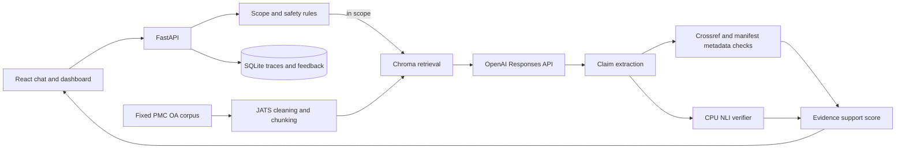

# MVP architecture

The safety path runs before retrieval and generation. The baseline uses the same generation adapter but bypasses retrieval and verification. Original drafts and post-verification responses are retained in SQLite for audit and analysis.

## Evidence score

The score combines supported-claim ratio (50%), valid-citation ratio (30%), and mean normalized retrieval relevance (20%). It is a project-specific ranking signal and must never be presented as a probability of medical correctness.

## Data boundary

No user authentication or patient profile exists in the MVP. The interface discourages personal medical details. API keys remain server-side, and the evaluation endpoint only accepts local requests.

