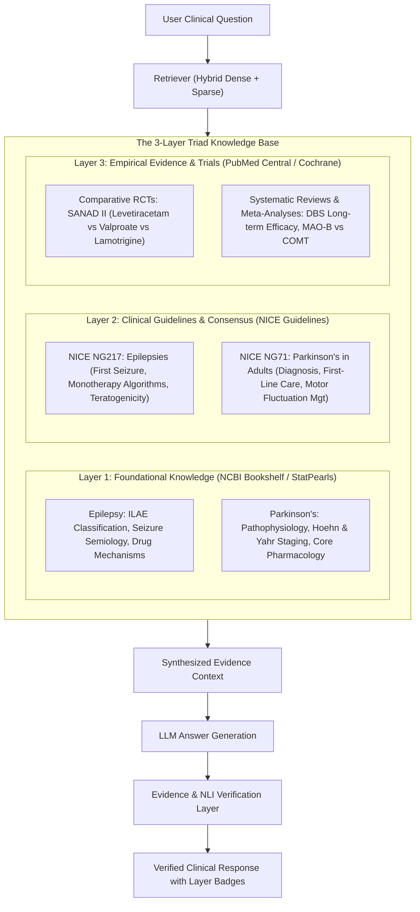

# 3-Layer Triad Knowledge Base Architecture

NeuroEvidence uses a **3-Layer Triad Knowledge Base** specialized for Parkinson's disease and epilepsy, paired with **Hybrid Dense + Sparse Retrieval**, biomedical NLI verification, and layer-badged clinical responses.

## Architecture Flow

## Knowledge Base Layers

### Layer 1: Foundational Knowledge (NCBI Bookshelf / StatPearls)
- **Epilepsy**:
  - *ILAE Classification*: 2017 classification of seizure types (focal, generalized, unknown onset; awareness level; motor vs non-motor).
  - *Seizure Semiology*: Cortical hypersynchrony, semiological progression, experiential aura, postictal state.
  - *Drug Mechanisms*: Cellular targets of antiseizure medications (voltage-gated sodium channel blockers, SV2A ligands, GABA potentiators, T-type calcium channels, multi-target modulators).
- **Parkinson's Disease**:
  - *Pathophysiology*: Substantia nigra pars compacta dopaminergic neurodegeneration, intracellular alpha-synuclein Lewy pathology, striatal dopamine deficit.
  - *Hoehn & Yahr Staging*: Severity rating from Stage 1 (unilateral involvement) to Stage 5 (bedridden or wheelchair-bound).
  - *Core Pharmacology*: Levodopa/carbidopa, non-ergot dopamine agonists, MAO-B inhibitors, wearing-off mechanisms.

### Layer 2: Clinical Guidelines & Consensus (NICE Guidelines)
- **NICE NG217 (Epilepsies)**:
  - Urgent specialist referral within 2 weeks after a suspected first unprovoked seizure; EEG & epilepsy-protocol MRI.
  - Monotherapy selection: Lamotrigine or levetiracetam first-line for focal seizures; sodium valproate (with safety criteria) or lamotrigine/levetiracetam for generalized tonic-clonic seizures.
  - Teratogenicity safety & Pregnancy Prevention Programme (Prevent) restricting sodium valproate.
- **NICE NG71 (Parkinson's in Adults)**:
  - Clinical diagnosis using UK Parkinson's Disease Society Brain Bank criteria; DaTscan for diagnostic uncertainty.
  - First-line pharmacotherapy stratified by quality-of-life impact (levodopa vs dopamine agonists vs MAO-B inhibitors; impulse control disorder counseling).
  - Motor fluctuation management (wearing-off dose fractioning, adjunctive COMT/MAO-B/DA, DBS referral for refractory fluctuations).

### Layer 3: Empirical Evidence & Trials (PubMed Central / Cochrane)
- **Comparative RCTs (SANAD II)**:
  - *Generalized/unclassified epilepsy arm* (*Lancet* 2021): Levetiracetam failed non-inferiority to sodium valproate for 12-month remission (HR 0.69).
  - *Focal epilepsy arm* (*Lancet* 2021): Levetiracetam failed non-inferiority to lamotrigine for 12-month remission; lamotrigine demonstrated superior treatment retention (HR 1.32).
- **Systematic Reviews & Meta-Analyses**:
  - *Deep Brain Stimulation (STN vs GPi)*: Long-term 5–10 year motor UPDRS III improvement, daily "off" time reduction by 4–6 hours, levodopa equivalent dose reduction.
  - *Adjuvant Pharmacotherapy (MAO-B vs COMT)*: Head-to-head Cochrane reviews showing equivalent ~1–1.5 hour reduction in daily "off" time; COMT associated with higher diarrhea and chromaturia; MAO-B with better GI profile.

## Hybrid Dense + Sparse Retrieval

The retrieval engine combines:
1. **Dense Retrieval**: Vector cosine similarity over document embeddings (ChromaDB in research mode; clinical concept projection in demo mode).
2. **Sparse Retrieval**: BM25 keyword matching with term frequency, document length normalization, and field weighting (title, subtopic, section, text).
3. **Reciprocal Rank Fusion (RRF)**:
   $$RRF(d) = \frac{\alpha}{60 + \text{rank}_{dense}(d)} + \frac{1 - \alpha}{60 + \text{rank}_{sparse}(d)}$$
   fusing dense semantic retrieval and sparse exact lexical matches.

## Verification & Layer Badging

- Responses are verified through claim extraction, Crossref/catalogue metadata validation, and CPU/transformer NLI entailment scoring.
- Retrieved evidence and inline citation pills display color-coded **Layer Badges**:
  - 🟦 **Layer 1: Foundational Knowledge** (NCBI Bookshelf / StatPearls)
  - 🟩 **Layer 2: Clinical Guidelines & Consensus** (NICE Guidelines)
  - 🟪 **Layer 3: Empirical Evidence & Trials** (PubMed Central / Cochrane)
