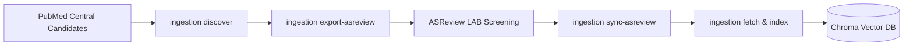

# ASReview Active Learning Screening Workflow

This document provides the end-to-end protocol for using **ASReview LAB** to accelerate literature screening for the NeuroEvidence research corpus.

---

## 1. Overview and Motivation

In evidence-based medicine and health informatics, screening hundreds of candidate publications manually is time-intensive. **ASReview LAB** is an open-source active learning tool developed by Utrecht University that re-ranks unlabelled literature based on machine learning (e.g., Naive Bayes or TF-IDF priors), allowing researchers to identify relevant articles significantly faster while minimizing bias.

In NeuroEvidence, ASReview is positioned between **Candidate Discovery** and **Corpus Indexing**:



---

## 2. Step-by-Step Protocol

### Step 2.1: Discover PMC Candidates
Run candidate discovery across the four target neurology topics (Parkinson's disease, epilepsy, stroke, multiple sclerosis):

```powershell
$env:PYTHONPATH = "backend"
.\.venv\Scripts\python.exe -m app.ingestion discover --per-topic 30
```
This generates `data/corpus_candidates.csv` with 120 candidate papers marked `included=no`.

---

### Step 2.2: Export to Topic-Specific ASReview Candidate Pools
Export candidates into separate disease-specific ASReview CSVs with abstracts:

```powershell
$env:PYTHONPATH = "backend"
# Export Parkinson's candidate pool (30 records):
python -m app.ingestion export-asreview --topic pd --asreview-pool data/asreview_pool_pd.csv

# Export Epilepsy candidate pool (30 records):
python -m app.ingestion export-asreview --topic ep --asreview-pool data/asreview_pool_ep.csv
```

*The exporter automatically queries PubMed E-utilities to retrieve abstracts for all records with PMIDs.*

---

### Step 2.3: Install and Launch ASReview LAB
Install ASReview in your environment and launch the browser interface:

```powershell
.\.venv\Scripts\pip.exe install asreview
asreview lab
```

Your default web browser will open `http://localhost:5000`.

---

### Step 2.4: Configure Screening Projects in ASReview (Two Separate Projects)
Create two focused projects to prevent cross-domain vocabulary dilution:

#### Project 1: Parkinson's Screening (`NeuroEvidence_Parkinsons`)
1. **Dataset:** Upload `data/asreview_pool_pd.csv`.
2. **AI Learner:** Select **ELAS u4** (Fast, lightweight TF-IDF learner).
3. **Prior Knowledge (Warm-up):**
   * Label **1 Relevant** paper (e.g. `PD-001` or `PD-003`).
   * Label **1 Irrelevant** paper (e.g. an animal study or out-of-scope paper).
4. Review abstracts and export decisions to `data/asreview_export_pd.csv`.

#### Project 2: Epilepsy Screening (`NeuroEvidence_Epilepsy`)
1. **Dataset:** Upload `data/asreview_pool_ep.csv`.
2. **AI Learner:** Select **ELAS u4**.
3. **Prior Knowledge (Warm-up):**
   * Label **1 Relevant** paper (e.g. `EP-001` or `EP-004`).
   * Label **1 Irrelevant** paper.
4. Review abstracts and export decisions to `data/asreview_export_ep.csv`.

---

### Step 2.5: Active Screening & Stopping Rule
* For each presented paper, review the title and abstract.
* Click **Relevant** (to include in the research corpus) or **Irrelevant** (to exclude).
* **Stopping Rule:** Screening can conclude after **10–15 consecutive irrelevant records** appear, as the pool is compact (30 candidates per topic).

---

### Step 2.6: Synchronize Decisions into NeuroEvidence Manifest
Run the automated synchronization command to update `data/corpus_manifest.csv` for each completed export:

```powershell
$env:PYTHONPATH = "backend"
# Sync Parkinson's decisions:
python -m app.ingestion sync-asreview --asreview-file data/asreview_export_pd.csv

# Sync Epilepsy decisions:
python -m app.ingestion sync-asreview --asreview-file data/asreview_export_ep.csv
```

The script identifies all records marked `included=1` and registers them into `data/corpus_manifest.csv` with `included=yes`.

---

### Step 2.8: Fetch and Index the Verified Corpus
Download the full JATS XML files and index them into ChromaDB:

```powershell
$env:PYTHONPATH = "backend"
.\.venv\Scripts\python.exe -m app.ingestion fetch --manifest data/corpus_manifest.csv
.\.venv\Scripts\python.exe -m app.ingestion index --manifest data/corpus_manifest.csv
```

---

## 3. Academic Defense: Thesis Methodology Text

In your FYP dissertation or project report, you can describe this process in the Methodology section as follows:

> *"To establish the domain-specific research corpus while controlling for selection bias and time constraints, an active-learning systematic screening pipeline was implemented using ASReview LAB v1.x. A candidate pool of 120 open-access peer-reviewed neurology papers was retrieved from PubMed Central. Screening was conducted with a TF-IDF feature extractor and Naive Bayes prior model. Screening concluded after reaching a stopping criterion of 25 consecutive irrelevant candidates. Selected publications were synchronized into the immutable corpus manifest and parsed via JATS XML into deterministic chunks for dense retrieval."*
