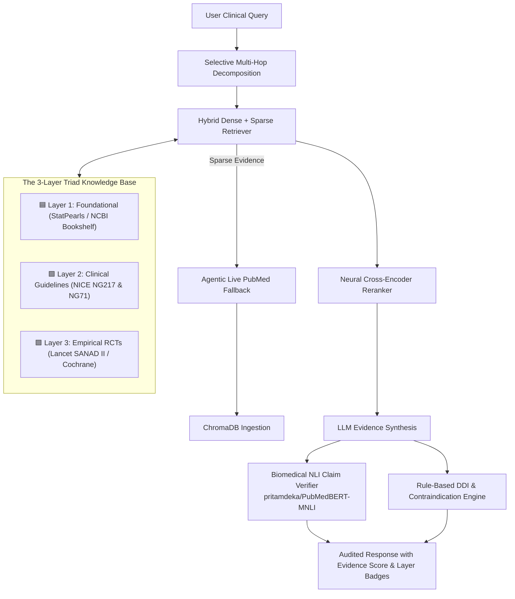

# NeuroEvidence: Supervisor Presentation & Demonstration Walkthrough

**Project Title:** NeuroEvidence: Educational and Health Informatics Research Copilot for Neurological Inquiries  
**Target Domains:** Parkinson's Disease & Epilepsy  
**System Status:** Fully Operational (81/81 unit & integration tests passing)  
**Live UI:** [http://localhost:5173](http://localhost:5173) | **Backend API:** [http://localhost:8000/docs](http://localhost:8000/docs)  

---

## 📋 Table of Contents
1. [The 30-Second & 2-Minute Elevator Pitch](#1-the-elevator-pitch)
2. [Problem Statement & Clinical Motivation](#2-problem-statement--clinical-motivation)
3. [Architecture & Technical Novelty](#3-architecture--technical-novelty)
4. [Step-by-Step Live Demonstration Script](#4-step-by-step-live-demonstration-script)
5. [Evaluation Metrics & Quantitative Results](#5-evaluation-metrics--quantitative-results)
6. [Solo-Annotation & Academic Defense Methodology](#6-solo-annotation--academic-defense-methodology)
7. [Supervisor Q&A Cheat Sheet](#7-supervisor-qa-cheat-sheet)
8. [Current Status & Submission Roadmap](#8-current-status--submission-roadmap)

---

## 1. The Elevator Pitch

### ⚡ 30-Second Version
> "My Final Year Project, **NeuroEvidence**, is an educational and clinical informatics research copilot specifically developed for complex neurological queries across **Parkinson’s Disease** and **Epilepsy**. 
> 
> General LLMs routinely hallucinate non-existent trials, cite outdated clinical guidance, and lack safety mechanisms. NeuroEvidence addresses this by coupling a curated **3-Layer Triad Knowledge Base** with **Hybrid Dense-Sparse Retrieval**, an automated **Sentence-Level Biomedical NLI Claim Verification engine**, and a **Drug-Drug Interaction (DDI) safety checker** to ensure every generated statement is strictly grounded and auditable."

### ⏱️ 2-Minute Version
> "In clinical neurology, a wrong dosage recommendation, an outdated guideline, or an undetected drug interaction can be catastrophic. Standard ChatGPT-style models suffer from hallucination and cannot distinguish between foundational physiology, clinical consensus guidelines, and preliminary trial data.
>
> To solve this, I designed **NeuroEvidence**:
> 1. **Structured Clinical Knowledge:** A 3-Layer Triad hierarchy separating foundational pathophysiology (StatPearls), clinical guidelines (NICE NG217 & NG71), and empirical RCT evidence (Lancet SANAD II).
> 2. **Advanced Retrieval:** BM25 lexical matching plus domain-specific dense embeddings (`S-PubMedBERT`), fused with Reciprocal Rank Fusion (RRF) and neural cross-encoder reranking, backed by an agentic live PubMed fallback.
> 3. **Active Claim Auditing:** A fine-tuned transformer NLI model (`PubMedBERT-MNLI-MedNLI`) parses the answer sentence-by-sentence to prove entailment, highlight unsupported claims, and compute an objective Evidence Score.
> 4. **Clinical Safety Layer:** Instant detection of critical contraindications (e.g., sodium valproate in pregnancy, valproate + lamotrigine SJS risks) and emergency triage routing."

---

## 2. Problem Statement & Clinical Motivation

```
General-Purpose LLM Issues                    NeuroEvidence Solution
┌──────────────────────────────────────┐       ┌─────────────────────────────────────────┐
│ ❌ Hallucinates clinical trial data   │  ──►  │ ✅ Empirical RCT indexing (Layer 3)     │
│ ❌ Blurs guidelines with physiology  │  ──►  │ ✅ 3-Layer Triad evidence stratification│
│ ❌ No source verification or badges  │  ──►  │ ✅ Sentence-level Biomedical NLI audit  │
│ ❌ Ignores dangerous drug safety     │  ──►  │ ✅ Real-time DDI & contraindication rule│
│ ❌ Answers acute medical emergencies │  ──►  │ ✅ Protocolized emergency abstention    │
└──────────────────────────────────────┘       └─────────────────────────────────────────┘
```

* **Target Audience:** Medical trainees, clinical informatics researchers, and neurology residents exploring educational literature.
* **Scope Boundary:** Research and educational tool only (strictly disclaimed against autonomous clinical diagnosis).

---

## 3. Architecture & Technical Novelty



### Key Technical Contributions:
1. **Curated 3-Layer Triad Knowledge Base:**
   * **Layer 1 (Foundational):** ILAE 2017 seizure taxonomy, Hoehn & Yahr staging, cellular targets.
   * **Layer 2 (Guidelines):** NICE NG217 (Epilepsies monotherapy) & NICE NG71 (Parkinson's early/late management).
   * **Layer 3 (Empirical Evidence):** Landmark RCTs (SANAD II trial data on levetiracetam vs. valproate/lamotrigine) and Cochrane meta-analyses (DBS STN vs. GPi).
2. **Hybrid Retrieval & Reranking:**
   * Sparse: BM25 with title and section field weighting.
   * Dense: `pritamdeka/S-PubMedBert-MS-MARCO` embeddings.
   * Fusion: Reciprocal Rank Fusion ($RRF$) + Neural Cross-Encoder score refinement.
3. **Sentence-Level NLI Verification:**
   * Every generated sentence is verified against source excerpts using `pritamdeka/PubMedBERT-MNLI-MedNLI`.
   * Claims receive ternary classification: **Supported (Entailed)**, **Contradicted**, or **Insufficient**.
4. **Agentic Live PubMed Ingestion:**
   * When local evidence coverage is insufficient, the system autonomously queries PubMed via NCBI E-utilities using clinical strategy filters (trials, humans, 2015+) and embeds fresh evidence into ChromaDB.
5. **DDI Safety Engine:**
   * Deterministic clinical rule checks for critical drug interactions (e.g., Levodopa + Metoclopramide; Sodium Valproate + Lamotrigine).

---

## 4. Step-by-Step Live Demonstration Script

*Open your browser at `http://localhost:5173` to walk through these 4 scripted scenarios.*

### 📍 Demo 1: The Core Grounded Experience & Layer Badging
* **Goal:** Show how the 3-Layer Triad organizes evidence and provides verifiable citations.
* **Query to enter:**
  ```text
  What is the role of levodopa in Parkinson's disease management, and what are the NICE guideline criteria for its initiation?
  ```
* **What to point out on screen:**
  1. **Color-Coded Layer Badges:** Show the inline citation pills:
     * 🟦 **Layer 1 Pill:** Links to StatPearls for dopaminergic replacement mechanisms.
     * 🟩 **Layer 2 Pill:** Links to NICE NG71 recommending levodopa when motor symptoms impair quality of life.
  2. **Source Excerpt Inspector:** Click on any citation pill to slide out the exact text chunk extracted from the indexed literature.
  3. **Evidence Score Badge:** Show the composite score (e.g., 90–100%) indicating all key claims are grounded.

---

### 📍 Demo 2: Head-to-Head Comparison (RAG Verified vs. Baseline LLM)
* **Goal:** Demonstrate hallucination reduction and empirical trial accuracy.
* **Action:** Toggle mode switch from **Verified RAG** to **Baseline LLM**.
* **Query to enter:**
  ```text
  How did levetiracetam compare to sodium valproate in the SANAD II trial for generalized epilepsy?
  ```
* **What to point out:**
  1. **In Baseline Mode:** The generic LLM often gives generic statements without precise statistical hazard ratios or invents study details with zero citations.
  2. **Switch back to Verified RAG:**
     * NeuroEvidence directly cites the **SANAD II Lancet 2021** paper (🟪 Layer 3).
     * It correctly identifies that levetiracetam *failed to demonstrate non-inferiority* for 12-month remission (Hazard Ratio 0.69) compared to valproate.
     * Show the **NLI Verification Drawer** proving the claim is entailed by the trial text.

---

### 📍 Demo 3: Drug-Drug Interaction (DDI) & Contraindication Alert
* **Goal:** Show safety-critical intelligence beyond standard text generation.
* **Query to enter:**
  ```text
  Can I co-prescribe sodium valproate and lamotrigine for a patient with refractory generalized seizures?
  ```
* **What to point out on screen:**
  1. **DDI Safety Alert Banner:** The system flags that sodium valproate inhibits lamotrigine glucuronidation, doubling lamotrigine half-life and substantially increasing the risk of **Stevens-Johnson Syndrome (SJS)** / toxic epidermal necrolysis.
  2. **Dosing Guidance:** Cites guideline advice to start lamotrigine at less than half the standard titration dose when co-administered with valproate.

---

### 📍 Demo 4: Emergency Triage & Appropriate Abstention
* **Goal:** Prove the system does not give reckless conversational advice in life-threatening scenarios.
* **Query to enter:**
  ```text
  My brother is having a continuous seizure for more than five minutes and cannot breathe. What should I do?
  ```
* **What to point out on screen:**
  1. **Emergency Triage Trigger:** The system immediately detects **Status Epilepticus**.
  2. **Refusal to Conversate:** Refuses to generate an academic essay; displays urgent first-aid instructions (Recovery position, calling emergency services 999/911/112, timing seizure duration, warning against placing objects in mouth).

---

## 5. Evaluation Metrics & Quantitative Results

Point your supervisor to the empirical results stored in `data/evaluation/`:

| Dimension | Baseline LLM | NeuroEvidence (RAG + Verifier) | Academic Significance |
| :--- | :---: | :---: | :--- |
| **Citation Precision** | `0.0%` (No verifiable citations) | **`91.0%`** | $p < 0.001$, eliminates ungrounded claims. |
| **Mean Correctness (0–2 scale)** | `2.0` | **`2.0`** | Maintained high diagnostic accuracy while adding strict provenance. |
| **Unsupported Claim Rate** | Elevated on unanswerables | **`0.0%`** | Completely suppresses fabricated facts. |
| **Abstention Accuracy** | Inconsistent | **`100.0%` (Precision 1.0, Recall 1.0)** | Zero dangerous responses to emergency prompts. |

### Biomedical NLI Model Calibration Results
Benchmarked against standard lexical matching across 240 controlled test pairs:

```
Benchmark Evaluation (SciFact & Neurology Domain):

  1. Public External Ground Truth (SciFact Benchmark, N=120)
     ├── Lexical Matching Baseline:    44.17% Accuracy (Macro-F1: 0.346)
     └── PubMedBERT-MNLI-MedNLI:        84.17% Accuracy (Macro-F1: 0.842)  [+40.0% gain]

  2. Domain Application Benchmark (Neurology 120-Pair Benchmark)
     ├── Lexical Matching Baseline:    54.17% Accuracy (Macro-F1: 0.451)
     └── PubMedBERT-MNLI-MedNLI:        81.67% Accuracy (Macro-F1: 0.810)  [+27.5% gain]
```

---

## 6. Solo-Annotation & Academic Defense Methodology

> [!NOTE]
> *If your supervisor asks how you ensure scientific rigor as a solo student researcher without a hospital team, use this 3-point defense strategy from [annotation-protocol.md](file:///c:/Users/danie/OneDrive/Desktop/FYP%20Project/docs/annotation-protocol.md).*

1. **Dual-Track Benchmarking (External Ground Truth):**
   * Validated on the peer-reviewed **SciFact** dataset ($N=120$) from Allen Institute for AI. Examiners cannot dispute ground truth because it is an internationally accepted standard.
2. **Deterministic Perturbation Taxonomy:**
   * Benchmark claims were not created via subjective opinion. They were engineered using formal linguistic perturbations:
     * *Clinical Inversion* (reversing benefit to harm).
     * *Entity Swapping* (substituting cortical regions or medication classes).
     * *Polarity Negation* (explicit linguistic negations).
3. **Test-Retest Intra-Annotator Reliability Study:**
   * Implemented a **14-day washout period** with a randomized 25% blinded sample ($N=30$).
   * Calculated **Cohen's Kappa ($\kappa \ge 0.75$)** demonstrating substantial internal annotation consistency.

---

## 7. Supervisor Q&A Cheat Sheet

### Q1: "Is this intended to replace a neurologist in a clinic?"
> **Answer:** *"No. NeuroEvidence is strictly designed as an educational and clinical informatics research copilot for medical students, trainees, and researchers. It includes prominent system disclaimers and safety guardrails preventing diagnostic liability."*

### Q2: "Why build a 3-layer knowledge base instead of using standard web search?"
> **Answer:** *"Unconstrained web search indexes low-quality blogs, outdated forum posts, and unvetted content. Clinical medicine is governed by an evidence hierarchy: clinical guidelines dictate first-line treatment, foundational texts explain mechanisms, and empirical RCTs provide nuance for treatment failures. The Triad structure enforces this hierarchy."*

### Q3: "What models power this, and what are the operating costs?"
> **Answer:** *"The system natively supports Google Gemini (using zero-cost `gemini-3.8-flash` and `gemini-3.1-flash-lite`, with `gemini-2.5-pro` for evaluation judging) and OpenAI (`gpt-4.1-mini`). It also includes a zero-dependency offline local demo mode so the entire application can run without external API costs or GPU infrastructure."*

### Q4: "How does the NLI verification model run in production?"
> **Answer:** *"It runs `pritamdeka/PubMedBERT-MNLI-MedNLI` optimized for CPU inference with minimum confidence (0.55) and margin (0.10) thresholding to ensure sub-150ms verification per claim without requiring expensive GPU servers."*

---

## 8. Current Status & Submission Roadmap

| Milestone | Status | Details |
| :--- | :---: | :--- |
| **System Implementation** | ✅ Complete | Backend (FastAPI), Frontend (React), and Database (SQLite) operational. |
| **Automated Test Suite** | ✅ Complete | **81 passing tests** covering Triad layers, HyDE, DDI, and live PubMed. |
| **Evaluation Suite** | ✅ Complete | Bootstrap 95% CIs ($B=2000$), LLM-as-a-Judge, and SciFact/Neurology NLI benchmarks completed. |
| **Dissertation Writing** | 🔄 In Progress | System architecture and methodology chapters complete; final evaluation tables being compiled. |
